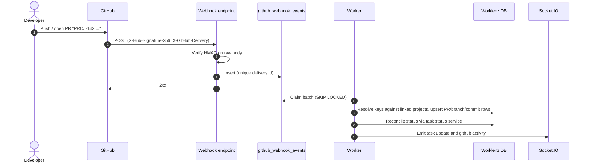
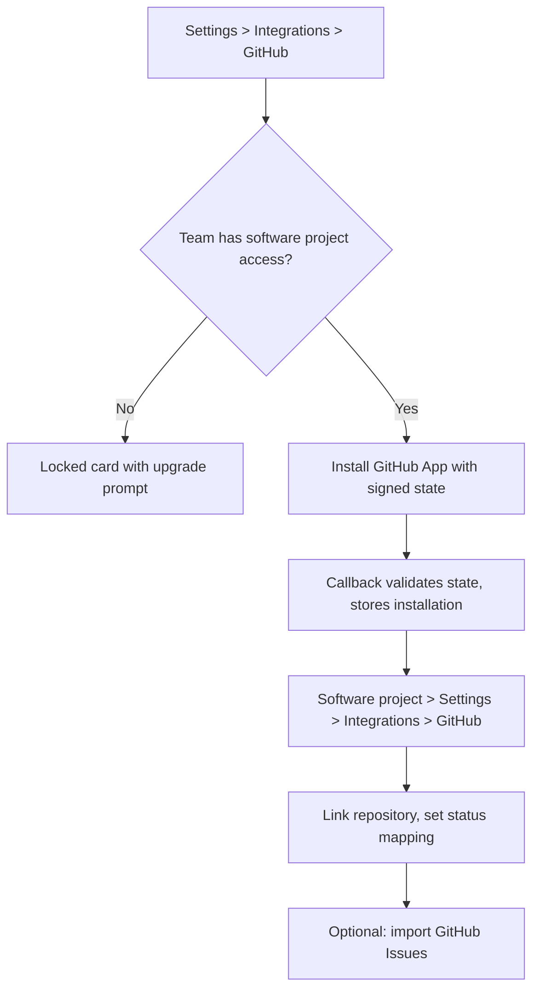
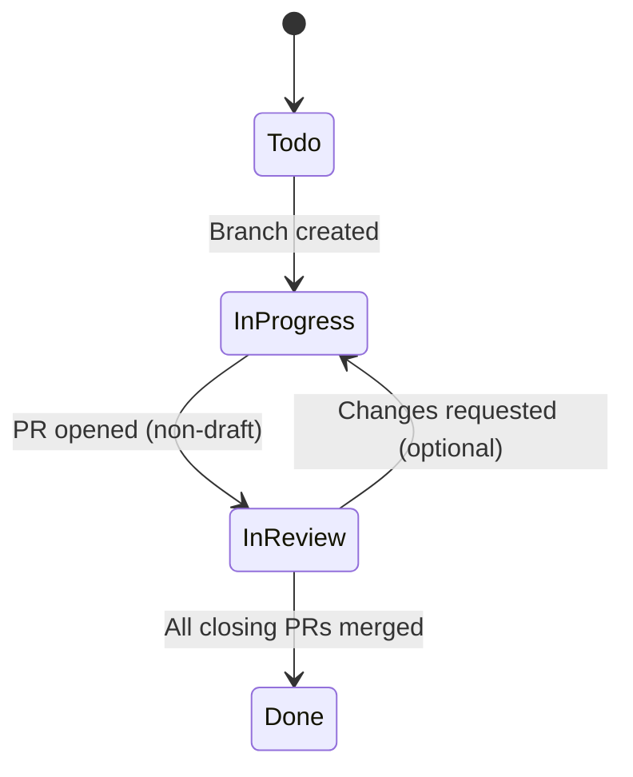

# Feature Specification: GitHub Integration for Software Projects

> **Target Module**: Integrations / Software Projects
> **Status**: Revised after feasibility review
> **Date**: 2026-10-14
> **Delivery**: Phased (see section 8)

---

## 1. Availability & Entitlement

GitHub integration has **no separate plan gate**. It is available to any team that can use **Software Projects**.

- The backend check is the same one that governs creating or using `project_type = 'software'` projects. Do not introduce a new plan or feature flag. If software project access changes, GitHub access changes with it.
- The team-level connection (`Settings > Integrations > GitHub`) is shown and enabled when the team has software project access. Teams without it see the card in a locked state with an upgrade prompt.
- The project-level panel (`Project Settings > Integrations > GitHub`) and the task drawer "Development" panel appear **only on software projects**.
- Self-hosted deployments: available only when the operator has configured the GitHub App environment variables (section 6.1). Otherwise the card shows "Not configured by administrator".

---

## 2. Overview

Software Projects provide backlogs, sprints, issue types, story points and releases. The GitHub integration connects those projects to GitHub repositories so developers can work in Git while Worklenz stays current.

Capabilities:
1. Link one or more repositories to a Software Project.
2. Surface branches, pull requests and commits on issues via issue keys (`PROJ-142`).
3. Optionally transition issue status from Git events, using a per-repository status mapping.
4. Import GitHub Issues into the backlog or a sprint (one-way; ongoing sync in a later phase).
5. Create a branch from the task drawer.
6. Later: milestone and release bridging, optional push-back to GitHub.

---

## 3. Goals & Non-goals

### Goals
- Developers work in GitHub; Worklenz reflects progress without manual status updates.
- Leads see linked PR review state and branch activity inside the issue.
- Multi-repository projects are supported.
- Webhook ingestion is verified, idempotent, asynchronous and order-tolerant.
- UI follows Worklenz standards: Ant Design tokens, light and dark themes, i18next with `defaultValue`.

### Non-goals
- Code viewer, diff viewer or in-browser IDE (link out to GitHub).
- GitHub Discussions or Wiki sync.
- GitHub Projects (v2) board sync.
- Automation for General projects (repo linking may be extended later; automation is software-only).
- Two-way field sync in the first releases (see section 8, Phase 4).
- CI/CD check status display (candidate for a later phase; not specified here).

---

## 4. Requirements

### 4.1 Functional

#### 4.1.1 GitHub App connection (team level)
- **FR-1.1**: Use an official **GitHub App** (not PATs). Authentication uses the app private key to mint a JWT, which is exchanged for short-lived installation tokens (about 1 hour, refreshed on demand and cached).
- **FR-1.2**: Team Owners and Admins start installation from `Settings > Integrations > GitHub`. The install redirect carries a signed, expiring `state` bound to the team and user; the callback rejects any `state` that is missing, invalid or expired.
- **FR-1.3**: Support installation on personal accounts and organizations, with "All repositories" or "Selected repositories". Repository lists are refreshed from `installation_repositories` webhooks.
- **FR-1.4**: Store `installation_id` and account metadata in `github_integrations`. Installation tokens are cached in memory or encrypted via the existing `EncryptionService`; they are not stored in plaintext.
- **FR-1.5**: Disconnect or uninstall pauses sync and branch creation but retains links, commits and PR history. Reconnecting resumes. Handle `installation` `deleted` and `suspend` webhooks.
- **FR-1.6**: One GitHub installation may be connected to one team at a time.

#### 4.1.2 Repository mapping (project level)
- **FR-2.1**: In a software project, Admins and Project Managers link one or more repositories available to the team's installation.
- **FR-2.2**: Per-repository settings:
  - Default base branch for branch creation.
  - **Status mapping** per event (see FR-5.1): each event maps to a project status or "do nothing". Defaults map to the project's status categories (to-do, doing, done), never to hard-coded status names.
  - Import GitHub Issues: on/off, label filter, default sprint or backlog.
  - Close issue on GitHub issue close: on/off.
- **FR-2.3**: Disconnecting a repository keeps existing links and tasks and stops future sync.

#### 4.1.3 Task drawer "Development" panel
- **FR-3.1**: On software issues, a "Development" panel shows:
  - **Branches** referencing the issue.
  - **Pull requests** with state (Draft, Open, Approved, Changes requested, Merged, Closed), reviewers and link.
  - **Commits** with short SHA, message, author, time and link.
  - **Linked GitHub issue** with state and number.
- **FR-3.2**: **Create Branch** action:
  - Pick repository (only linked repos), base branch, prefix (`feature/`, `bugfix/`, `hotfix/`, `chore/`) and name (default `<issue-key>-<slug>`, sanitized and length-limited to valid git ref rules).
  - Creates the ref through the GitHub API and links it to the issue.
  - Offers a one-click copy of the checkout command. Because the branch already exists on GitHub, the command is `git fetch origin && git checkout -b <name> origin/<name>`.
  - Requires the Contents write permission (section 6.2).

#### 4.1.4 Issue key detection
- **FR-4.1**: Issue keys match the project's real keys, not a fixed pattern. Detection:
  1. Candidate pattern `\b([A-Za-z][A-Za-z0-9]*-\d+)\b`, case-insensitive on input.
  2. Each candidate's prefix is resolved against the keys of **projects linked to that repository**. Unknown prefixes are ignored.
  3. The number resolves to a task by `(project_id, task_no)`.
  This avoids mismatches because project keys can be 1 character, may grow with collision suffixes, and are unique only within a team.
- **FR-4.2**: Sources: commit messages, branch names, PR title, PR body, PR branch name.
- **FR-4.3**: Closing keywords (`closes`, `fixes`, `resolves`) before a key mark a PR as "closes this issue". Plain references only link. Multiple keys per message are supported.
- **FR-4.4**: Links are many-to-many: an issue can have several PRs and repos; a PR can reference several issues.

#### 4.1.5 Automated status transitions
- **FR-5.1**: Events that can trigger a transition, each configurable per repository via the status mapping:
  - Branch created
  - PR opened (non-draft) or marked ready for review
  - PR approved
  - PR merged
  - PR closed without merge
  - GitHub issue closed / reopened
- **FR-5.2**: Transitions are **state-reconciling and conservative**:
  - Compute the target from the issue's current PR set (for example, move to done only when all PRs that close the issue are merged; otherwise stay in review while any is open).
  - Never move an issue backward from a done-category status unless the mapped event is "issue reopened".
  - Skip archived issues and issues in completed sprints.
  - Out-of-order events are handled by evaluating the latest known state from stored PR/branch rows, not the event alone.
- **FR-5.3**: Transitions go through the **existing task status update path** (same service as manual changes), so sprint rules, notifications, sockets and activity logs behave identically. The actor is a "GitHub" system actor, with the GitHub user and PR number in the activity text.
- **FR-5.4**: Boards, backlogs and open drawers update in real time via the existing Socket.IO events.

#### 4.1.6 GitHub Issues import (one-way)
- **FR-6.1**: "Import GitHub Issues" modal lists unlinked issues with state and label filters. Users select issues and a destination (backlog or a sprint).
- **FR-6.2**: Mapping:
  - Title to name; body (Markdown) to description (converted to the supported rich text format).
  - Labels to issue type via a configurable mapping (defaults: `bug` to bug, `enhancement`/`feature` to story, otherwise task).
  - Assignee to team member via the GitHub identity link (FR-6.4); unmatched assignees are left unassigned.
  - Milestone is recorded on the link; sprint mapping is Phase 4.
- **FR-6.3**: Optional "auto-import" for issues matching the label filter when opened in GitHub. Closing the GitHub issue can close the linked issue (setting from FR-2.2).
- **FR-6.4**: **GitHub identity link**: members connect their GitHub login once (OAuth user identification through the GitHub App). Matching by commit email is not used because emails are often private or noreply.

#### 4.1.7 Sprints, milestones and releases (Phase 4)
- Associate a sprint with a GitHub milestone, and a project release with a tag or GitHub release. Optional push of generated release notes. Specified in detail when scheduled.

#### 4.1.8 Monitoring
- **FR-8.1**: A team-level "Sync status" view in Settings shows last webhook time, failed event count and a retry action for failed events.
- **FR-8.2**: Platform-wide metrics (received, processed, failed, rate-limit use) go to the existing `worklenz-admin` app, scheduled after the core phases.

### 4.2 Non-functional

- **NFR-1 Reliability**: The webhook endpoint verifies the signature, inserts the raw payload and returns `202`/`200` quickly (target under 500ms). All parsing, DB work and broadcasts run in a background worker using the `SKIP LOCKED` queue pattern already used by import and export workers. Link visibility target: under 10 seconds p95.
- **NFR-2 Idempotency**: `X-GitHub-Delivery` is stored with a unique constraint; duplicates are dropped. Handlers are replay-safe.
- **NFR-3 Security**:
  - HMAC-SHA256 verification of `X-Hub-Signature-256` over the **raw body** with constant-time comparison, using the GitHub App's webhook secret from environment config. Invalid signatures return `401`.
  - The webhook route is outside session and CSRF protection (like the DirectPay webhook); it must be excluded explicitly.
  - Webhook payloads map to a team through `installation_id`; payloads for unknown installations are dropped.
  - Private key, client secret and webhook secret are read from environment configuration and never logged.
  - Least-privilege app permissions (section 6.2).
- **NFR-4 Performance**: Pushes with up to 20 commits are processed as one batch. Indexes on `(project_id, repository_id)`, `(task_id)`, `(repository_id, number)`, and a unique index on delivery ID. Retry GitHub API calls with exponential backoff, honoring `Retry-After` and secondary rate limit responses (max 3 retries per job; then marked failed and visible in FR-8.1).
- **NFR-5 UX**: Light and dark theme through Ant Design tokens, keyboard and ARIA support, loading, empty and error states on every new screen, responsive layout.
- **NFR-6 Localization**: All strings via i18next with English `defaultValue`, in the existing integrations and task-drawer namespaces and all supported locales.
- **NFR-7 Data**: UUID primary keys with `uuid_generate_v4()`; migrations via `node-pg-migrate` in `database/pg-migrations`, reversible.

---

## 5. Data Model (summary)

| Table | Purpose |
|---|---|
| `github_integrations` | Team to `installation_id`, account login/type, status, connected by/at |
| `github_repositories` | Repos available to the installation (`github_repo_id`, full name, default branch) |
| `github_project_repositories` | Project to repo link plus settings and status mapping (JSONB) |
| `github_user_links` | Team member to GitHub login/id |
| `github_branches` / `github_pull_requests` / `github_commits` | Stored Git state |
| `github_task_links` | Many-to-many from task to branch, PR or commit, with `closes` flag |
| `github_issue_links` | Task to GitHub issue number, state, last synced |
| `github_webhook_events` | Raw payload, delivery ID (unique), status, attempts, error, timestamps |

---

## 6. Technical Notes

### 6.1 Deployment configuration
`GITHUB_APP_ID`, `GITHUB_APP_PRIVATE_KEY`, `GITHUB_APP_WEBHOOK_SECRET`, `GITHUB_APP_CLIENT_ID`, `GITHUB_APP_CLIENT_SECRET`, `GITHUB_APP_SLUG`. Cloud uses one Worklenz GitHub App. Self-hosted operators register their own App with a publicly reachable webhook URL; the feature stays hidden if the variables are absent.

### 6.2 GitHub App permissions
- Metadata: read
- Contents: **write** (branch creation; read-only if branch creation is disabled)
- Pull requests: read
- Issues: read (write only when push-back ships in Phase 4)

Subscribed events: `push`, `create`, `delete`, `pull_request`, `pull_request_review`, `issues`, `installation`, `installation_repositories`.

### 6.3 Routes
- Webhook: `POST /webhook/github` (raw body, no session/CSRF).
- Authenticated API under `/api/v1/github/*` with the standard session, CSRF and software-access checks.

### 6.4 GitHub App registration (setup guide)

Register one **GitHub App** (not an OAuth App) under the owning organization: `Settings > Developer settings > GitHub Apps > New GitHub App`. Use separate apps for dev and production, each with its own secrets and URLs.

**Basic information**
- Homepage URL: the Worklenz site.
- Callback URL: `https://<domain>/api/v1/github/callback` (add a second URL for local development).
- Setup URL: the same callback, with "Redirect on update" enabled.
- "Request user authorization (OAuth) during installation": enabled (used for the member identity link, FR-6.4).
- "Expire user authorization tokens": enabled.

**Webhook**
- Active: yes.
- URL: `https://<domain>/webhook/github`. It must be publicly reachable; use a tunnel (smee.io, ngrok, cloudflared) for local development.
- Secret: generate with `openssl rand -hex 32`; stored as `GITHUB_APP_WEBHOOK_SECRET`.

**Permissions**

| Scope | Permission | Access | Used for |
|---|---|---|---|
| Repository | Metadata | Read | Required default |
| Repository | Contents | Read & write | Create Branch (read-only if branch creation is disabled) |
| Repository | Pull requests | Read | PR state and reviews |
| Repository | Issues | Read | Import (write only for Phase 4 push-back) |
| Account | none | none | Identity comes from the user authorization flow |

Changing permissions later forces every installation to re-approve, so decide on Contents write before launch.

**Subscribe to events**: `Push`, `Create`, `Delete`, `Pull request`, `Pull request review`, `Issues`, `Installation`, `Installation repositories`. Event checkboxes appear only after the matching permission is set.

**Installability**: "Any account" for cloud; "Only on this account" is enough for internal testing.

**After creation**
1. Record the App ID, Client ID and App slug (`github.com/apps/<slug>`).
2. Generate a client secret.
3. Generate a private key (`.pem`). It cannot be downloaded again; store it securely.
4. Set the environment variables from section 6.1 (`GITHUB_APP_PRIVATE_KEY` accepts the PEM contents or base64).

**Testing**
- Install the dev app on a throwaway organization with a test repository.
- Use the App page's `Advanced > Recent deliveries` to inspect payloads and responses and to redeliver events.
- Self-hosters repeat this with their own App and a public webhook URL; an [app manifest](https://docs.github.com/en/apps/sharing-github-apps/registering-a-github-app-from-a-manifest) may be offered later to automate it.

---

## 7. Flows

### Ingestion

### Connect and map

### Issue lifecycle (defaults, all configurable)

---

## 8. Delivery Phases

| Phase | Scope | Estimate |
|---|---|---|
| 1 | App connection, repo mapping, webhook queue, key detection, Development panel (read-only) | 2-3 weeks |
| 2 | Status mapping and automated transitions, activity log, sockets, Create Branch, GitHub identity link | 1-2 weeks |
| 3 | One-way GitHub Issues import and auto-import, sync status view | 1-2 weeks |
| 4 | Optional push-back, milestone and release sync, admin metrics in `worklenz-admin` | scheduled separately |

---

## 9. Acceptance Criteria

### 9.1 Availability and connection
- [ ] A team with software project access sees GitHub enabled; a team without sees it locked.
- [ ] No separate plan or flag exists for GitHub.
- [ ] Only Owners/Admins can connect or disconnect; the callback rejects an invalid or expired `state`.
- [ ] Connected state shows account, repository count and date; disconnect pauses sync and keeps history.
- [ ] Self-hosted without App configuration shows "Not configured".

### 9.2 Repository mapping
- [ ] Software project Admins/PMs can link multiple repositories; General projects cannot.
- [ ] Status mapping lists the project's actual statuses; defaults use status categories.
- [ ] Unlinking leaves tasks and history intact.

### 9.3 Development panel and branch creation
- [ ] Branches, PRs, commits and linked issue render with states, in light and dark themes.
- [ ] Create Branch validates the ref name, creates it on GitHub, links it and offers a copyable checkout command.

### 9.4 Detection and transitions
- [ ] A key in a commit, branch or PR links to the issue; unknown prefixes and keys from non-linked projects are ignored.
- [ ] Keys of 1 character or with collision suffixes resolve correctly.
- [ ] Transitions follow the repo status mapping and go through the standard status path (sprint rules, notifications, activity log applied).
- [ ] With two PRs closing one issue, the issue reaches done only after both merge.
- [ ] Out-of-order or duplicated deliveries produce the same final state; duplicate delivery IDs are ignored.
- [ ] Archived issues and completed-sprint issues are not transitioned.

### 9.5 Import
- [ ] Import maps title, Markdown description, label-based type and matched assignee; unmatched assignees stay unassigned.
- [ ] Re-importing an already linked issue is blocked.

### 9.6 Security and reliability
- [ ] Bad signatures return `401` and are not stored.
- [ ] Valid payloads are persisted and acknowledged within 500ms under load.
- [ ] Failed jobs retry with backoff up to 3 times, then appear with a retry action.
- [ ] All new strings are localized with `defaultValue`; all tables use UUID PKs.
